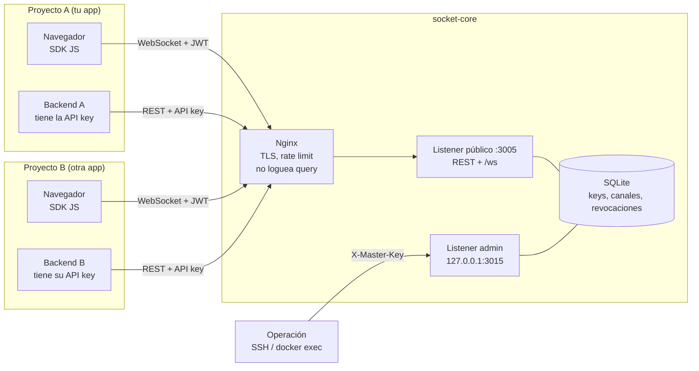

# Cómo funciona socket-core

Guía para alguien que no conoce el sistema. Todo lo que aparece aquí se ha
**ejecutado** contra un hub temporal o **leído del código** de este repositorio
(`src/`). Los secretos reales aparecen como `***`.

> Los bloques marcados como `bash-doc-exec` son ejecutables y se comprueban en
> `scripts/test_docs_curl.py`. Para ejecutarlos necesitas un hub local y:
>
> ```bash
> export CORE=http://127.0.0.1:3005
> export ADMIN=http://127.0.0.1:3015   # listener admin (en el VPS vía docker exec)
> export MASTER='...'                  # MASTER_KEY del hub temporal
> ```

---

## 1. Visión general



- Cada **proyecto** tiene una **API key** (secreta, solo backend).
- El backend del proyecto pide **JWT** de corta vida para sus usuarios y se los
  entrega al navegador. El navegador solo ve el JWT.
- El **hub** aísla proyectos: canales, presencia, listados y estadísticas están
  filtrados por proyecto; lo ajeno responde 404.
- El **listener admin** escucha solo en loopback dentro del contenedor y no se
  publica; se usa para crear/editar/revocar keys y ver estadísticas globales.

---

## 2. Las tres credenciales

| Credencial | Qué es | Quién la tiene | Puede | NO puede / dónde NUNCA debe estar |
|---|---|---|---|---|
| **MASTER_KEY** | Secreto de administración del hub (≥32 chars). | Solo el operador del hub (`.env` del servidor). | Crear/editar/revocar/borrar keys, revocar JWT, ver `/admin/stats`. | No sirve para publicar/suscribirse ni para autenticar usuarios. Nunca en backends de proyecto, frontends, repos, logs ni capturas. |
| **API key** (`sc_live_...`) | Credencial del **proyecto** (se guarda hash en SQLite; se muestra una vez). | Solo el **backend** del proyecto. | REST: pedir JWT (`/auth/token`), crear/borrar canales (scope `manage`), publicar (scope `publish`), listar sus canales/clientes/stats. | No es un JWT: **no** sirve como `Bearer` ni como token de WebSocket (401). No debe llegar al navegador ni a logs. |
| **JWT** | Token firmado de corta vida (HS256, `iss`/`aud=socket-core`, TTL por defecto 600 s). | Navegador/cliente final (el backend lo emite). | Abrir `/ws` (rol `subscribe`), publicar por WS/REST (rol `publish`), limitado al proyecto y canal del claim. | No da acceso a admin, ni a otros proyectos, ni a canales fuera de su claim. No se debe reutilizar a largo plazo. |

Detalle del código: los scopes vivos de la API key se comprueban al usar un JWT
(retirar `publish` invalida tokens viejos para publicar), y una key revocada o
borrada invalida sus JWT al instante.

---

## 3. Recorrido completo (con respuestas reales)

Hub temporal usado: `APP_ENV=dev`, `JWT_TTL_SECS=600`. Salidas reales con
`sc_live_***` y `***JWT***`.

### 3.1 Salud

```bash-doc-exec
curl -s "$CORE/health"
```

Respuesta real:

```json
{"service":"socket-core","status":"ok"}
```

### 3.2 Alta del proyecto (crear API key)

Requiere la MASTER_KEY. En local se llama al listener admin directo; en el VPS se
hace por `docker exec` (ver §7). El prefijo no puede solaparse con otro proyecto.

```bash-doc-exec
KEY_JSON=$(curl -s -X POST "$ADMIN/admin/keys" \
  -H "X-Master-Key: $MASTER" -H "Content-Type: application/json" \
  -d '{"name":"demo","domains":["https://app.example"],"channel_prefix":"demo:*","scopes":["publish","subscribe","manage"],"rate_limit_per_min":120}')
API_KEY=$(printf '%s' "$KEY_JSON" | sed -E 's/.*"api_key":"([^"]+)".*/\1/')
KEY_ID=$(printf '%s' "$KEY_JSON" | sed -E 's/.*"id":"([^"]+)".*/\1/')
printf 'key creada: id=%s api_key=sc_live_***\n' "$KEY_ID"
```

Respuesta real (redactada):

```json
{"success":true,"data":{"id":"e8b3bdeb-...","name":"demo","api_key":"sc_live_***","domains":["https://app.example"],"channel_prefix":"demo:*","scopes":["publish","subscribe","manage"],"rate_limit_per_min":120,"expires_at":null},"error":null}
```

### 3.3 Crear un canal

`manage` solo es necesario para crear/borrar canales.

```bash-doc-exec
curl -s -X POST "$CORE/channels" \
  -H "X-Api-Key: $API_KEY" -H "Content-Type: application/json" \
  -d '{"name":"demo:chat","description":"chat de ejemplo"}'
```

Respuesta real:

```json
{"success":true,"data":{"id":"9bae0669-...","name":"demo:chat","project_id":"e8b3bdeb-...","description":"chat de ejemplo","created_at":1792872866,"clients_count":0},"error":null}
```

Listado (solo canales del proyecto):

```bash-doc-exec
curl -s "$CORE/channels" -H "X-Api-Key: $API_KEY"
```

```json
{"success":true,"data":[{"id":"9bae0669-...","name":"demo:chat","project_id":"e8b3bdeb-...","description":"chat de ejemplo","created_at":1792872866,"clients_count":0}],"error":null}
```

### 3.4 Usuario inicia sesión en la app y el backend pide el JWT

El backend identifica al usuario y envía un `user_id` **opaco** (no email). El JWT
queda limitado al canal y rol:

```bash-doc-exec
TOK_JSON=$(curl -s -X POST "$CORE/auth/token" \
  -H "X-Api-Key: $API_KEY" -H "Content-Type: application/json" \
  -d '{"user_id":"user-1","channel":"demo:chat","role":"both"}')
TOKEN=$(printf '%s' "$TOK_JSON" | sed -E 's/.*"token":"([^"]+)".*/\1/')
printf 'jwt emitido para user-1 (***JWT***), expires_in=600\n'
```

```json
{"success":true,"data":{"token":"***JWT***","expires_in":600,"channel":"demo:chat","role":"both"},"error":null}
```

### 3.5 Navegador abre el WebSocket con el SDK

El navegador usa `sdk/js/socket-core.mjs`; el `tokenProvider` llama a **tu**
endpoint (`/socket-token`), que a su vez pide el JWT al hub con la API key. El
token viaja en `?token=` (el navegador no permite cabeceras en WS) y Nginx está
configurado para **no registrar query strings**.

El SDK funciona en navegador y **Node.js ≥ 22** (WebSocket nativo; sin cliente
propio).

```js
import { connect, tokenFromEndpoint } from "./socket-core.mjs";
const sc = connect({
  url: "wss://hub.ejemplo.com",
  channel: "demo:chat",
  device: "portatil",
  tokenProvider: () => tokenFromEndpoint("/socket-token", { method: "POST" }),
});
```

Ejecución real contra el hub temporal (dos navegadores simulados, user-1 y user-2):

```text
estados: ["A:connected","B:connected"]
presencia (A): [{"type":"client_joined","user":"user-1","total":1},{"type":"client_joined","user":"user-2","total":2}]
```

Handshake que envía el SDK tras abrir:

```json
{"channel":"demo:chat","device":"portatil"}
```

### 3.6 Publicar y recibir

```js
await sc.publish({ type: "chat", text: "hola desde user-1" });
```

Salida real del receptor:

```json
{"source":"demo:user-1","payload":{"text":"hola desde user-1","type":"chat"}}
```

`source` lo impone el servidor como `proyecto:sub` (no se puede falsificar por WS).

Alternativa backend (REST con API key; para publicar por REST con JWT, el rol debe
incluir `publish`):

```bash-doc-exec
curl -s -X POST "$CORE/channels/demo:chat/events" \
  -H "X-Api-Key: $API_KEY" -H "Content-Type: application/json" \
  -d '{"source":"backend-demo","targets":["*"],"payload":{"type":"chat","text":"hola desde el backend"}}'
curl -s "$CORE/stats" -H "X-Api-Key: $API_KEY"
```

```json
{"success":true,"data":{"success":true},"error":null}
{"success":true,"data":{"channels":1,"total_clients":0},"error":null}
```

`stats` cuenta solo canales y clientes de **tu** proyecto.

### 3.7 Expira el token y renovación sin cortes

Con `JWT_TTL_SECS=600`, el SDK renueva ~60 s antes de expirar: abre una **nueva**
conexión, espera su handshake y cierra la vieja. Mientras se solapan, deduplica
eventos por `id`. Si el servidor cierra por expiración, el código es
`token_expired` y el SDK reconecta pidiendo otro JWT.

Durante el solape hay **dos conexiones del mismo usuario**: el `client_left` de la
vieja puede llegar cuando la nueva ya está activa. En la UI hay que **contar
conexiones por usuario con un Set de `connection_id`** y **sembrar la foto inicial**
con `GET /channels/:id/clients` vía el backend del proyecto (el ejemplo expone
`GET /presence` y usa `examples/frontend/presence.mjs`). Un usuario solo se marca
desconectado cuando su Set queda vacío.

Ejecución real con un hub de TTL=60 s para forzar la renovación en segundos
(producción usa 600 s):

```text
estados renovación: ["connected","renewing","connected","renewing","connected"]
recibido tras renovar: true
```

### 3.8 Revocación de la API key

Revocar (o borrar, o editar prefijo/scopes) cierra **al instante** los WebSockets
del proyecto con `credential_revoked`, y sus JWT dejan de valer (401).

Ejecución real con un WS abierto:

```text
estados: ["connected","renewing","connected","renewing","connected","renewing"]
fatal: {"code":"credential_revoked","detail":"credencial revocada"}
```

Comprobación REST:

```bash
curl -s -X POST "$ADMIN/admin/keys/$KEY_ID/revoke" -H "X-Master-Key: $MASTER"
test "$(curl -s -o /dev/null -w '%{http_code}' "$CORE/channels" -H "X-Api-Key: $API_KEY")" = 401
test "$(curl -s -o /dev/null -w '%{http_code}' -X POST "$CORE/channels/demo:chat/events" \
  -H "Authorization: Bearer $TOKEN" -H "Content-Type: application/json" \
  -d '{"source":"x","targets":["*"],"payload":{"t":1}}')" = 401
echo "revocación OK (401 en key y JWT)"
```

```json
{"success":true,"data":{"revoked":true},"error":null}
revocación OK (401 en key y JWT)
```

---

## 4. Aislamiento entre proyectos (ejemplo real)

Proyecto **beta** con prefijo `beta:*` y canal `beta:masked`. El proyecto `demo`
intenta acceder:

```bash-doc-exec
BETA_JSON=$(curl -s -X POST "$ADMIN/admin/keys" \
  -H "X-Master-Key: $MASTER" -H "Content-Type: application/json" \
  -d '{"name":"beta","domains":["https://beta.example"],"channel_prefix":"beta:*","scopes":["publish","subscribe","manage"]}')
BETA_KEY=$(printf '%s' "$BETA_JSON" | sed -E 's/.*"api_key":"([^"]+)".*/\1/')
curl -s -X POST "$CORE/channels" -H "X-Api-Key: $BETA_KEY" \
  -H "Content-Type: application/json" -d '{"name":"beta:masked"}' >/dev/null
test "$(curl -s -o /dev/null -w '%{http_code}' "$CORE/channels/beta:masked" -H "X-Api-Key: $API_KEY")" = 404
test "$(curl -s -o /dev/null -w '%{http_code}' -X POST "$CORE/channels/beta:masked/events" \
  -H "X-Api-Key: $API_KEY" -H "Content-Type: application/json" \
  -d '{"source":"x","targets":["*"],"payload":{"t":1}}')" = 404
test "$(curl -s -o /dev/null -w '%{http_code}' -X POST "$CORE/channels/beta:masked/events" \
  -H "Authorization: Bearer $TOKEN" -H "Content-Type: application/json" \
  -d '{"source":"x","targets":["*"],"payload":{"t":1}}')" = 404
test "$(curl -s -o /dev/null -w '%{http_code}' -X POST "$CORE/channels/demo:chat/events" \
  -H "Authorization: Bearer $API_KEY" -H "Content-Type: application/json" \
  -d '{"source":"x","targets":["*"],"payload":{"t":1}}')" = 401
test "$(curl -s -o /dev/null -w '%{http_code}' "$CORE/admin/keys" -H "X-Master-Key: $MASTER")" = 404
echo "aislamiento OK: 404/404/404/401/404"
```

Resultados reales por vía:

| Intento de A (demo) contra B (beta) | Respuesta real |
|---|---|
| REST `GET /channels/beta:masked` con API key de A | **404** |
| REST `POST /channels/beta:masked/events` con API key de A | **404** |
| REST `POST /channels/beta:masked/events` con JWT de A | **404** |
| WebSocket a `beta:masked` con JWT de A (canal `demo:chat` en el claim) | fatal **`not_found`** — `{"code":"not_found","detail":"canal no encontrado"}` |
| API key de A como `Authorization: Bearer` (REST) | **401** (una API key no es un token) |
| `GET /admin/keys` en el puerto público | **404** (admin solo en loopback) |
| Listados/stats | Solo el proyecto propio (stats de demo: `channels:1`) |

> 404 (no 403) es deliberado: no se filtra si el canal existe en otro proyecto.

Comprobación ejecutable de revocación (último paso de la secuencia):

```bash-doc-exec
curl -s -X POST "$ADMIN/admin/keys/$KEY_ID/revoke" -H "X-Master-Key: $MASTER"
test "$(curl -s -o /dev/null -w '%{http_code}' "$CORE/channels" -H "X-Api-Key: $API_KEY")" = 401
test "$(curl -s -o /dev/null -w '%{http_code}' -X POST "$CORE/channels/demo:chat/events"   -H "Authorization: Bearer $TOKEN" -H "Content-Type: application/json"   -d '{"source":"x","targets":["*"],"payload":{"t":1}}')" = 401
echo "revocación OK (401 en key y JWT)"
```

```json
{"success":true,"data":{"revoked":true},"error":null}
revocación OK (401 en key y JWT)
```

---

## 5. Qué pasa ante fallos

| Situación | Comportamiento real |
|---|---|
| **Reinicio del servidor** | Los canales persisten en SQLite (y su dueño). Las conexiones WS no persisten: el SDK recibe el cierre de red, espera con backoff+jitter y reconecta. Con `SIGTERM` los WS reciben `server_shutdown` antes de cerrar (gracia `SHUTDOWN_GRACE_SECS=10`). |
| **JWT expirado** | El REST responde 401; el WS se cierra con `token_expired`. El SDK renueva ~60 s antes de expirar; si no pudo, reconecta con un token nuevo. |
| **API key revocada/borrada** | Todas sus conexiones se cierran con `credential_revoked` y sus JWT dejan de valer (401). No es reintentable: el SDK emite `fatal`. |
| **Cliente lento** | El buffer de broadcast del canal es 1000 eventos. Si se desborda, el cliente recibe `{"type":"missed_events","missed":N}` y **no** se le cierra en silencio; debe re-sincronizar (no hay historial). |
| **DB caída** | Fail-closed: si no se puede validar la key o comprobar la revocación, se responde **500** (no 401/200) y se registra el error. Comprobado por los tests `api_key_con_db_caida_da_500_no_401` y `fallo_de_db_en_revocacion_es_fail_closed`. |
| **Proxy mal configurado** | Si la IP del socket no está en `TRUSTED_PROXIES`, se ignoran `X-Forwarded-For`/`X-Real-IP`: todos los clientes comparten la IP del gateway para el rate limit (puede limitar de más) y no se puede banear por IP real. `estado.py` avisa si no coincide con el gateway de `central_network`. |
| **Timeout de handshake / flood** | Sin handshake en 8 s → `handshake_timeout`. >50 publicaciones/s por conexión o >500/s por proyecto → `rate_limited` y cierre. Frame >64 KB → `message_too_large`. |
| **Apagado** | Tras la señal se avisa `server_shutdown`, se cierra la aceptación y se espera hasta `SHUTDOWN_GRACE_SECS`; después el proceso termina aunque queden conexiones. |

---

## 6. Límites y cuotas (valores reales)

Leídos de `src/limits.rs`, `src/config.rs`, `src/models.rs`, `src/handlers.rs`,
`src/middleware.rs` y `src/channel_manager.rs` en este commit.

| Límite | Valor | Dónde se ajusta |
|---|---|---|
| TTL del JWT | 600 s (rango válido 60–3600; el arranque rechaza fuera de rango) | `JWT_TTL_SECS` (env) |
| Tamaño de payload/frame WS | 64 KB | `WS_MAX_MESSAGE_BYTES` / `Limits::max_message_bytes` |
| Timeout de handshake WS | 8 s | `WS_HANDSHAKE_TIMEOUT_SECS` |
| Conexiones WS por proyecto | 50 | `WS_MAX_CONNECTIONS_PER_PROJECT` |
| Conexiones WS por IP | 20 | `WS_MAX_CONNECTIONS_PER_IP` |
| Publicaciones por conexión | 50/s | `WS_PUBLISH_PER_SEC` |
| Publicaciones agregadas por proyecto | 500/s | `WS_PUBLISH_PER_PROJECT_PER_SEC` |
| Ping / inactividad | 30 s / 120 s | `WS_PING_INTERVAL_SECS`, `WS_IDLE_TIMEOUT_SECS` |
| Revalidación de credenciales del WS (watchdog) | 10 s | `Limits::auth_recheck_secs` |
| Peticiones por IP (REST) | 600/min | `Limits::ip_rate_per_min` |
| Rate limit por API key | `rate_limit_per_min` de la key (por defecto 120 al crearla) | campo de la key (`/admin/keys`) |
| Rate extra de emisión por IP | 600/min | constante en `handlers::emit_event` |
| Fallos de MASTER_KEY antes de bloquear | 5 | `Limits::admin_fail_max` |
| Duración del bloqueo admin | 60 s | `Limits::admin_lock_secs` |
| Body HTTP máximo | 1 MB | `DefaultBodyLimit` en `build_public_router` |
| Targets por evento | 50 (128 chars cada uno) | `MAX_TARGETS`, `MAX_TARGET_LEN` |
| Profundidad JSON del payload | 16 | `MAX_PAYLOAD_DEPTH` |
| Longitud nombre de canal / descripción / sub | 128 / 500 / 128 | `models.rs` |
| Buffer de eventos por canal | 1000 | `channel_manager::broadcast::channel(1000)` |
| Limpieza periódica | 300 s; rate limiter TTL 120 s | `CLEANUP_INTERVAL_SECS`, `RATE_LIMITER_TTL_SECS` |
| Gracia de apagado | 10 s | `SHUTDOWN_GRACE_SECS` (env) |

**Cómo ajustarlos:** `JWT_TTL_SECS` y `SHUTDOWN_GRACE_SECS` son variables de
entorno. El resto son constantes compiladas en `src/limits.rs` (y los límites de
payload/nombres en `src/models.rs`): se cambian en código y se reconstruye la
imagen; si usas el hub embebido, puedes inyectar `AppState.limits` distinto.

---

## 7. Guía de operación

### 7.1 Acceso a `/admin` (vía elegida)

El listener admin escucha en `127.0.0.1:ADMIN_PORT` **dentro del contenedor** y no
se publica. Usa `docker exec`:

```bash
MASTER=$(grep ^MASTER_KEY= .env | cut -d= -f2)
dc() { docker exec -i socket-core curl -sS "$@"; }

# Listar keys (metadatos; no expone secretos)
dc http://127.0.0.1:3015/admin/keys -H "X-Master-Key: $MASTER"
# Estadísticas globales por proyecto (sin payloads)
dc http://127.0.0.1:3015/admin/stats -H "X-Master-Key: $MASTER"
# Crear proyecto (mejor con scripts/alta_cliente.py)
dc -X POST http://127.0.0.1:3015/admin/keys -H "X-Master-Key: $MASTER" \
  -H 'Content-Type: application/json' \
  -d '{"name":"demo","channel_prefix":"demo:*","domains":["https://app.example"],"scopes":["publish","subscribe"],"rate_limit_per_min":120}'
# Editar (solo lo enviado)
dc -X PATCH http://127.0.0.1:3015/admin/keys/<KEY_ID> -H "X-Master-Key: $MASTER" \
  -H 'Content-Type: application/json' -d '{"rate_limit_per_min":300}'
# Revocar / borrar
dc -X POST http://127.0.0.1:3015/admin/keys/<KEY_ID>/revoke -H "X-Master-Key: $MASTER"
dc -X DELETE http://127.0.0.1:3015/admin/keys/<KEY_ID> -H "X-Master-Key: $MASTER"
# Revocar un JWT concreto (necesitas su jti)
dc -X POST "http://127.0.0.1:3015/admin/tokens/revoke?jti=<JTI>" -H "X-Master-Key: $MASTER" \
  -H 'Content-Type: application/json' -d '{}'
```

`scripts/alta_cliente.py` crea el paquete de credenciales (fichero 0600), lista los
prefijos en uso y explica el error de prefijo solapado.
`scripts/estado.py` comprueba contenedor, salud, `/admin/stats`, Nginx, certificado,
fail2ban y `TRUSTED_PROXIES`.

### 7.2 Rotar secretos

| Rotación | Efecto real | Procedimiento |
|---|---|---|
| **JWT_SECRET** | Solo invalida los **JWT** (firma). Las **API keys** siguen valiendo (están hasheadas en SQLite y no dependen del secreto). | Cambiar en `.env`, reiniciar. Los clientes piden JWT nuevo (el SDK reconecta). |
| **MASTER_KEY** | Solo cambia la autenticación del **admin**. No afecta a API keys, JWT ya emitidos ni canales. | Cambiar en `.env`, reiniciar; actualizar el gestor de secretos. |
| **API key de un proyecto** | Invalida esa key y **sus JWT** (por proyecto). | Crear key nueva (mismo prefijo no: primero hay que borrar/renombrar la vieja porque los prefijos no se solapan), entregar al backend, revocar la vieja. Alternativa: `PATCH` para rotar scopes/expiración; para rotar la key completa, crear nueva y borrar la antigua. |

### 7.3 Backups y restauración

- El deploy guarda `backups/data-AAAAMMDD-HHMMSS.tgz` **antes** de reconstruir
  (retención de 10) y registra el commit previo en `.last_deploy_commit`.
- Manual: `sudo tar czf backup.tgz data` con el contenedor parado o aceptando la
  consistencia de SQLite (mejor parar).
- Restaurar: parar, descomprimir sobre `data/`, `sudo chown -R 10001:10001 data`,
  arrancar.
- Rollback completo: ver `SECURITY.md §7`.

### 7.4 Logs y auditoría

- Los eventos de auditoría se emiten con `target=audit` e incluyen
  `project=... action=... outcome=...` (altas/ediciones/revocaciones/borrados de
  keys, revocación de tokens, borrado de canales y autenticaciones fallidas), sin
  secretos.
- `RUST_LOG=info` muestra arranque, canales restaurados y avisos.
- Los errores internos (DB/JWT) van al log; al cliente solo llega un mensaje
  genérico.
- `scripts/estado.py` resume salud, stats por proyecto, Nginx, cert, fail2ban y
  coherencia de `TRUSTED_PROXIES`.

---

## 8. Checklist para integrar una app nueva (10 minutos)

1. **Crea el proyecto** en el hub: `python3 scripts/alta_cliente.py` (o POST
   `/admin/keys` con `X-Master-Key`). Guarda el paquete 0600 y muévelo al gestor de
   secretos del proyecto; borra el fichero.
2. **Backend**: guarda la API key en variable de entorno. Añade un endpoint
   (`/socket-token`) que identifique al usuario y llame a `POST /auth/token` con
   `user_id` **opaco**, `channel` de tu prefijo y `role` (`both`/`publish`/`subscribe`).
3. **Frontend**: importa `sdk/js/socket-core.mjs` (cópialo a tu proyecto), crea
   `connect({ url, channel, device, tokenProvider })` y escucha
   `message`/`presence`/`missed_events`/`fatal`/`status`.
4. **Publica** con `sc.publish(payload, { targets })`. Targets = `user_id`s.
5. **Prueba**: dos navegadores en el mismo canal deben verse; `estado.py` debe
   mostrar el canal y las conexiones de tu proyecto.
6. **Operación**: si cambias scopes/prefijo o revocas la key, los WS se cierran y
   los JWT viejos dejan de valer (comportamiento esperado).

Ejemplo completo ejecutable: `examples/README.md` (backend Express + chat).

---

## 9. Limitaciones conocidas y riesgos residuales (honesto)

- **Una sola instancia**: canales y conexiones viven en memoria del proceso; no hay
  clustering ni replicación. SQLite tampoco está pensado para múltiples escritores
  concurrentes.
- **Sin persistencia de mensajes**: un cliente desconectado **pierde** los eventos.
  `missed_events` solo avisa a un cliente conectado que se quedó atrás; no hay
  historial ni reintento de entrega.
- **`domains` protege solo el uso desde navegador y solo al emitir el JWT**: no se
  valida en el WebSocket ni protege llamadas backend-to-backend.
- **REST `source` lo fija el backend**: los frontends no deben usarlo para
  decisiones de seguridad. Por WS el servidor lo sobrescribe con `proyecto:sub`.
- **`sub` debe ser un ID opaco** (no emails): se muestra al resto del canal en
  presencia y eventos de sistema.
- **El watchdog consulta SQLite** cada 10 s por conexión para detectar revocaciones
  hechas directamente en DB (las hechas por la API cierran al instante por el bus de
  control). Con muchas conexiones añade carga a SQLite.
- **El JWT viaja en la query** del WS: Nginx está configurado para no registrar
  query strings, pero cualquier otro proxy/log intermedio podría hacerlo. Mantén el
  TTL corto y revisa la configuración de logs.
- **Admin solo por loopback**: no hay panel web. La operación es `docker exec`/SSH.
- **Rate limit por IP** depende de una correcta `TRUSTED_PROXIES`; mal configurada,
  todos los clientes comparten el cupo del gateway.
- **Reserva de prefijos**: una key revocada sigue ocupando su prefijo hasta que se
  borra o se edita (el solape incluye keys revocadas). El error del servidor nombra
  la key que ocupa el prefijo (sin secretos); bórrala o cámbiale el prefijo para
  liberarlo.
